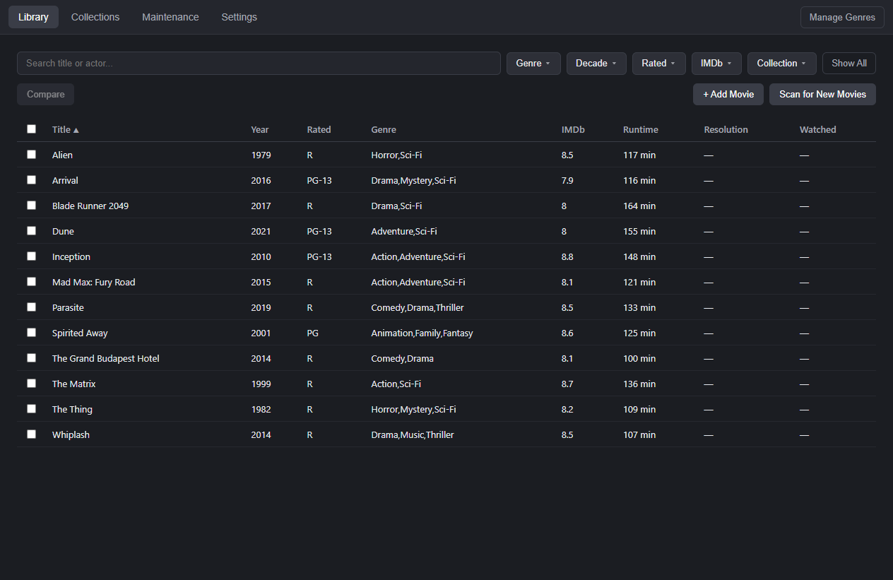
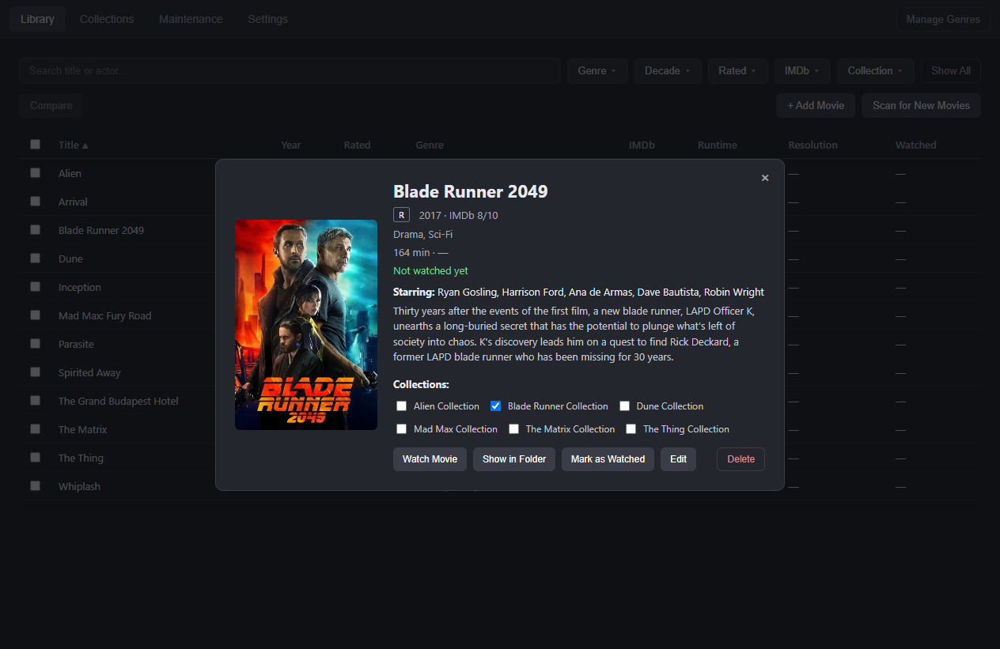
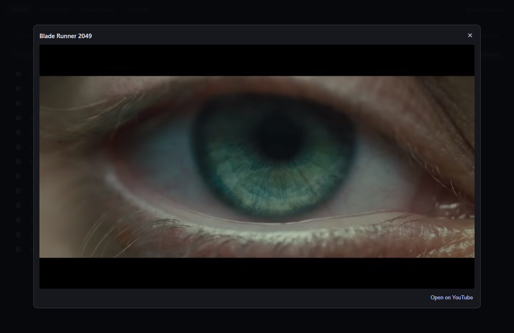
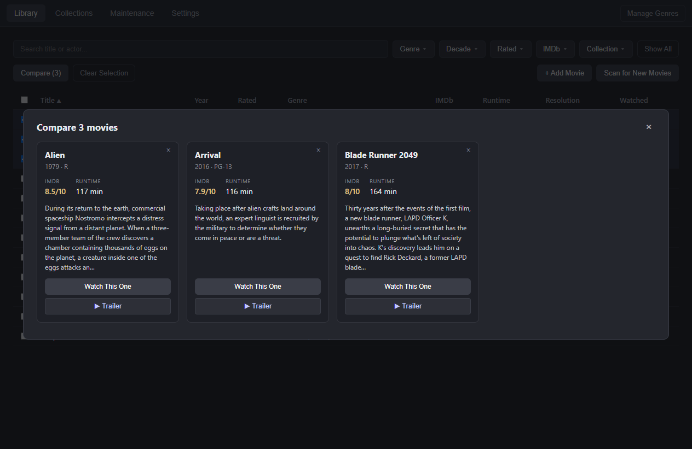
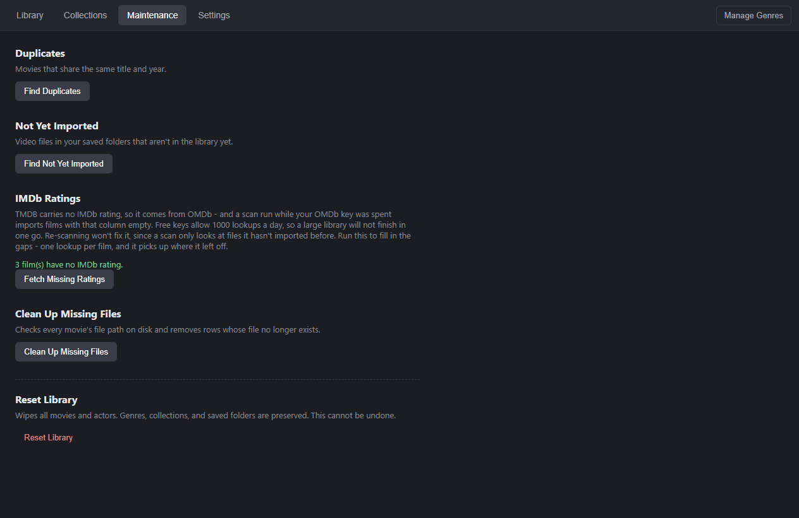
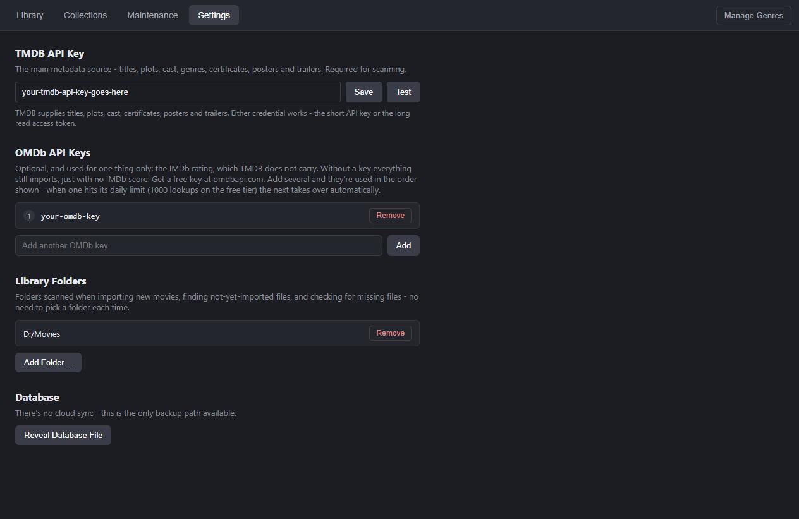

# My Movie Library

A desktop app for cataloguing a local movie collection. Point it at the folders where
your video files live, and it identifies each film, pulls its metadata, and gives you a
searchable, filterable library — including trailers that play inside the app.

Electron + Vue 3 + SQLite. Windows-focused, and deliberately still able to run on
Windows 7 (see [Why Electron 22](#why-electron-22)).



## What it does

**Import** — recursively scans your watch folders for `.avi .mp4 .mkv .m4v .mpg .ts`,
works out which film each file is, and fetches its metadata. Only files it hasn't seen
before are processed, so re-scanning after adding a few films is quick.

**Browse** — sort by title, year, certificate, IMDb rating, runtime, resolution or
watched date. Filter by genre, decade, certificate, rating band and collection.
Full-text search covers titles *and* cast, using a trigram index so partial words match.
**Latest Import** narrows the grid to whatever the most recent scan brought in, in import
order with the newest at the bottom, so a fresh batch can be checked over before it
disappears into the library.

**Organise** — group films into collections, manage your own genre list, mark films
watched, and launch them in your default player.

**Maintain** — find duplicates, find files on disk that were never imported, clean up
entries whose files have gone missing, or reset the library entirely. Because every import
links its TMDB franchise, most collections end up holding one or two films — so collections
below a size you choose can be deleted in bulk, or cleared out altogether. Neither touches
a movie.

### Details, and trailers

Clicking a film opens its details. Clicking the **poster** plays the trailer in an
overlay — the dialog underneath stays exactly as you left it.





### Comparing films

Tick two or more films and compare them side by side. Each card has its own **▶ Trailer**
button, and as with the detail view, playing one doesn't close the comparison.



## Where the metadata comes from

Two sources, with a clear division of labour:

| Source | Supplies | Required? |
|---|---|---|
| **[TMDB](https://www.themoviedb.org/)** | Title, year, plot, runtime, genres, US certificate, poster, top-5 billed cast, franchise, **trailer** | **Yes** |
| **[OMDb](https://www.omdbapi.com/)** | The IMDb rating, and nothing else | No |

OMDb is optional because TMDB carries everything except the IMDb rating. Without an OMDb
key every film still imports — the IMDb column is simply empty. A spent or invalid OMDb
key costs you ratings, not the scan.

That has a consequence worth knowing about on a large library. Free OMDb keys allow 1,000
lookups a day, so a library past a thousand films **will** finish its first scan with some
ratings missing. Re-scanning won't fix it — a scan only looks at files it hasn't imported
before, so those films are never revisited. **Maintenance → Fetch Missing Ratings** fills
the gaps, one lookup per film, and resumes where it left off when the daily limit resets.



Each file costs three requests: one to resolve it to a TMDB id, one for the metadata
(TMDB's `append_to_response` returns details, videos, credits and certificates in a
single call), and one to OMDb for the rating. Five files are processed concurrently.

## Getting started

Requires Node 18+ and Windows.

```bash
npm install
npm run dev
```

Then, in the app:

1. **Settings → TMDB API Key** — paste a key from
   [themoviedb.org/settings/api](https://www.themoviedb.org/settings/api). Either
   credential works: the short v3 API key or the long v4 read access token. **Test**
   checks it before you rely on it.
2. **Settings → OMDb API Keys** *(optional)* — a free key from
   [omdbapi.com](https://www.omdbapi.com/apikey.aspx) adds IMDb ratings. Free keys allow
   1,000 lookups a day; add several and the app moves to the next when one is spent.
3. **Settings → Library Folders** — add the folders holding your films.
4. **Library → Scan for New Movies**.



No API keys ship with the app. Everything is stored locally in SQLite under
`%APPDATA%`, and there is no cloud sync — **Settings → Reveal Database File** is your
backup path.

## Filename conventions

Identification works best with either of these:

```
The Matrix (1999).mkv
The Matrix 1999 (tt0133093).mkv     <- an IMDb id is authoritative
```

Extra decoration is tolerated — `Title (Director's Cut) (1999).mkv` and
`Title (1999) [1080p].mkv` both work, as does a name that opens with a bracket, like
`(500) Days of Summer (2009).mkv`.

Scene-style names without brackets are handled as a fallback: dots become spaces and
release tags are stripped, so `The.Matrix.1999.1080p.BluRay.x264-AMIABLE.mkv` resolves
correctly. Punctuation needs no special care — searching `Mad Max Fury Road` finds
*Mad Max: Fury Road*.

Anything that can't be matched is skipped and reported, never guessed at. You can always
add a film by hand, or by IMDb id, from **+ Add Movie**.

## Building a release

```bash
npm run build:win
```

Produces an NSIS installer in `release/` for both x64 and ia32.

> **Then run `npm run rebuild:dev`.**
>
> `build:win` rebuilds `better-sqlite3` once per architecture and leaves the last one
> (ia32) in `node_modules`. Dev mode is x64, so without this step it fails at startup
> with `ERR_DLOPEN_FAILED — not a valid Win32 application`. This bites every time.

## How the trailer player works

Worth documenting, because the obvious approach doesn't work.

YouTube's embedded player refuses to start when the embedding page has no HTTP referrer.
That's exactly a packaged build: the app loads its renderer with `loadFile()`, giving it
a `file://` origin, and Chromium sends no referrer from `file://`. Measured in
Electron 22 against a real `file://` renderer:

| Approach | Result |
|---|---|
| Plain `<iframe>` to YouTube | `onError 153` |
| Same, plus a `Referer` header injected via `webRequest` | `onError 152` |
| Framed by a page served over `http://127.0.0.1` | **plays** |

Header injection isn't enough because the player reads `document.referrer` — a
navigation property — not the request header. So the trailer sits one frame deeper: a
tiny loopback server ([`src/main/trailerServer.js`](src/main/trailerServer.js)) serves a
single static page that frames YouTube, giving the embed a real http origin to inherit a
referrer from.

The server binds to `127.0.0.1` on an ephemeral port, serves exactly one route, requires
a token generated fresh each launch, and only starts the first time you actually play a
trailer. The wrapper page also listens for the player's error events, so a video whose
owner has disabled embedding shows an "Open on YouTube" panel instead of a black
rectangle.

Note that this problem is invisible in development, where the renderer is served over
`http://localhost` and a plain iframe works fine.

## Project layout

```
src/
  main/            Electron main process
    db/            SQLite schema and repositories
    importer/      Scanning, filename parsing, TMDB/OMDb clients, ffprobe
    ipc/           IPC handlers, one module per domain
    log/           Diagnostic log - formatting, redaction, file rotation
    trailerServer.js
  preload/         contextBridge API - an explicit whitelist, no generic invoke
  renderer/src/    Vue 3 app (components, views, Pinia stores)
```

The renderer never talks to the filesystem, the database or the network directly.
Everything goes through the preload bridge, which exposes a fixed list of named channels.

## Diagnostics

When something fails, the reason is written to a log file rather than a console
nobody can see in a packaged build:

```
%APPDATA%\movielib-web\logs\movie-library.log
```

The folder is the package name, not the product name, so a packaged build and
`npm run dev` share it - and share the database beside it. The first line of
the log is a banner recording its own path, which is the authoritative answer
if that ever changes.

**Settings → Diagnostics → Reveal Log File** opens it in Explorer, ready to attach
to a bug report. It is capped at 2 MB, with one previous file kept beside it.

What it records: every failed IPC call with its channel and arguments, every
failed TMDB or OMDb request with the HTTP status and the redacted URL, every
database error with its `SQLITE_*` code, and the things the scanner otherwise
swallows - an unreadable watch folder, a file ffprobe could not read.

**API keys are never written to it.** Keys travel in query strings, so every
line is scrubbed of `api_key=` / `apikey=` values, `Bearer` tokens and bare
JWTs on its way to disk - and the arguments of the three channels that carry a
key (`settings:setTmdbKey`, `settings:testTmdbKey`, `omdbKeys:add`) are never
logged at all. The file does contain paths from your library.

Verbosity defaults to `info` in a packaged build and `debug` in dev:

```
set MOVIELIB_LOG=debug      # per-file scan detail, every successful IPC call
set MOVIELIB_LOG_SQL=1      # every SQL statement - very noisy, dev only
```

All IPC handlers register through `handle()` in `src/main/ipc/handle.js`, which
is what guarantees a failure cannot go unlogged. `grep -rn "ipcMain.handle" src/main/ipc/`
should only ever match that one file.

## Why Electron 22

Electron 22 is the last version supporting Windows 7/8/8.1, and this app is expected to
run on a Windows 7 machine. That pin cascades: `better-sqlite3` stays on 8.x (the newer
major targets a Node-API version newer than Electron 22's bundled Node 16), and HTTP goes
through Electron's `net` module rather than `fetch`, which doesn't exist in Node 16 — a
bonus on Windows 7, since `net` uses Chromium's TLS stack rather than the host's long
unpatched one.

## Licence

MIT
